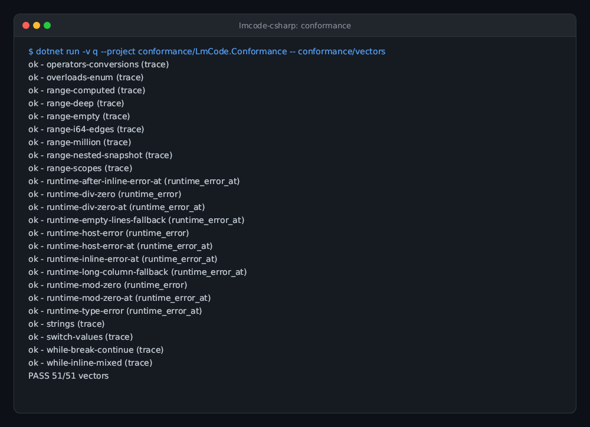
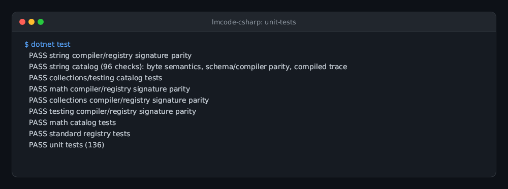
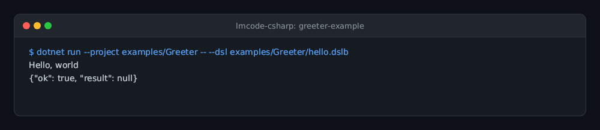
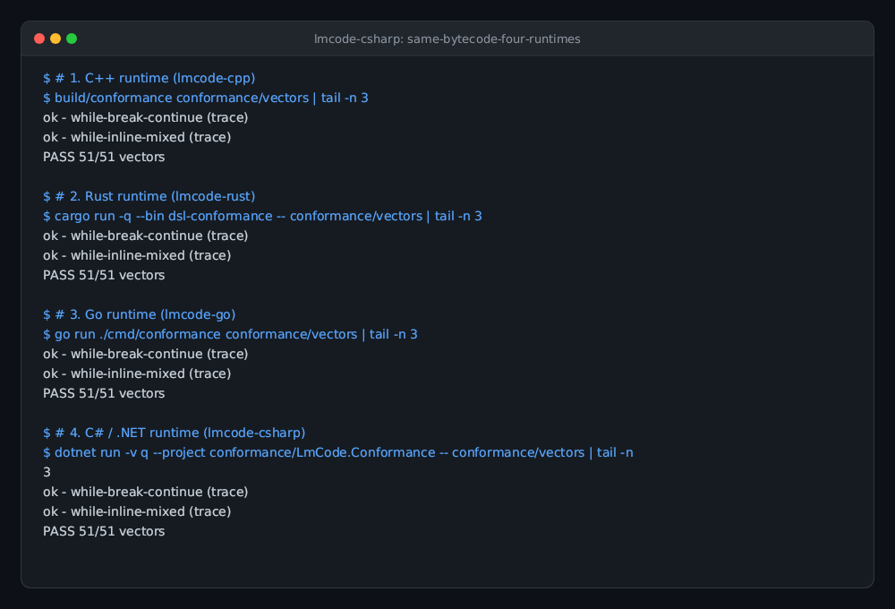

# lmcode-csharp

A dependency-free .NET 8 SDK for embedding lmscript bytecode v6 in C# hosts. Namespace
`LmCode` provides a typed registry, schema-bound loader, structural verifier, VM,
per-run object context, and source-located errors. NativeAOT is supported without
reflection or generated dynamic code.

Experimental: bytecode compatibility is not promised. The SDK reads version 6 only;
compiler, SDK and host must move together when the format version changes. Pin an
SDK commit and matching compiler version.

## Gallery

| **Bytecode Conformance Suite** | **Unit Tests & Invariants** |
| --- | --- |
|  |  |
| All 397 core bytecode vectors pass across opcodes, types, error paths, and control flow.<br>`dotnet run --project conformance/LmCode.Conformance -- conformance/vectors` | 293 unit/contract checks and standard catalog tests covering C# SDK invariants.<br>`dotnet test` |

| **Greeter Example Host** | **Same Bytecode, Four Runtimes** |
| --- | --- |
|  |  |
| Minimal embedding host compiling and executing DSL logic in .NET 8 / C#.<br>`dotnet run --project examples/Greeter -- --dsl hello.dslb` | Shared bytecode contract for C++, Rust, Go, and C#. This C# port verifies its pinned corpus; the image shows an earlier four-runtime snapshot. |

## Embed

Reference `src/LmCode/LmCode.csproj` from your host (`dotnet add reference PATH`), or
vendor that directory. No NuGet package is published and the library declares no
package dependencies. The .NET SDK restores its own AOT/analyzer tooling.

The complete small host is [examples/Greeter/Program.cs](examples/Greeter/Program.cs):

```csharp
using LmCode;
using VmProgram = LmCode.Program;

var schema = """{"dsl.schema":2,"name":"greeter","types":{},"functions":{"greet":[{"params":["string"],"returns":"void"}]},"context":{}}"""u8.ToArray();
var registry = new Registry();
registry.Function("greet", ["string"], "void", (_, values) =>
{
    Console.Error.WriteLine("Hello, " + values[0].AsStr());
    return Value.None;
});
if (args is ["--dsl-schema", "--json"]) { Console.OpenStandardOutput().Write(schema); return 0; }
if (args is ["--dsl-signatures"]) { Console.WriteLine(string.Join('\n', registry.Signatures())); return 0; }
if (args is not ["--dsl", var path]) return 2;
VmProgram program;
try { program = VmProgram.Load(File.ReadAllBytes(path), schema, registry); }
catch (Error error) { return Reports.ReportError("load", error); }
try { program.Run(new Context(), registry); return Reports.ReportOk("null"); }
catch (Error error) { return Reports.ReportError("run", error); }
```

`Registry.Context(name, type)` declares an object name; `Context.SetObject(name,
 type, object)` binds it per run. `Registry.Method(type, name, parameters, returns,
 callback)` receives the context, receiver `ObjRef`, and ordered `Value[]` arguments.
Use `context.Get<T>(receiver)` to access a host object. Objects and handles belong to
one context; do not move handles between contexts. Register overloads with distinct
parameter tuples. `Signatures()` returns sorted canonical schema signatures.

VM strings are immutable **bytes**, including NUL and invalid UTF-8. `Value.Str`
accepts `VmString`, and `AsStr()` returns it. Construct from `ReadOnlySpan<byte>`
and use `.Span` for lossless access; `FromString`/`ToString` explicitly encode/decode
UTF-8 for hosts that want text. Do not round-trip arbitrary VM bytes through C# strings.
Integers wrap as signed 64-bit values, including `long.MinValue / -1`; division and
remainder by zero raise `RUN_ERROR`. Floats are binary64.

## Build and test

```sh
dotnet build -c Release -warnaserror
dotnet test
dotnet run --project conformance/LmCode.Conformance
dotnet run --project examples/Greeter -- --dsl examples/Greeter/hello.dslb
dotnet publish examples/Greeter -r linux-x64 -c Release -p:PublishAot=true
```

`dotnet test` runs the package-free console regression suite through MSBuild; no
xUnit or other test framework is used. The conformance command runs every checked-in
vector and exits nonzero on failure. `scripts/sync-vectors.sh` copies vectors from
`../lmcode-cpp` and records its source commit; it never regenerates them.

To rebuild the example bytecode with a compatible `lmscript` compiler:

```sh
cd examples/Greeter
lmscript hello.lm
```

CI builds, tests, runs all vectors, publishes NativeAOT, and executes the native
Greeter on Linux x64/arm64, macOS x64/arm64, and Windows x64. Linux NativeAOT requires
clang and zlib development headers. AOT removes the .NET runtime installation
requirement; the Linux executable still dynamically links system libc and libm.

## Standard library catalog

`new Registry()` installs all 206 lmcode std v3 signatures automatically, including
strings, math, collections and raw-byte file helpers. Testing helpers remain
optional explicit registrations. No group-registration code or
handwritten standard declarations are needed. Before compiler injection lands,
merge the canonical `std/lmcode-std.schema.json` into the build's compiler schema
with `lmcode-cpp/scripts/merge-std.py`, then embed those exact merged bytes.
Explicit group binders remain available for opt-out and compatibility code:

```csharp
var registry = new Registry();
LmCode.Stdlib.StringCatalog.RegisterString(registry);
```

All 16 C++ catalog functions are available: `str_len`, `str_starts_with`,
`str_ends_with`, `str_contains`, `str_find`, `str_substr`, `str_lower`, `str_upper`,
`str_trim`, `str_repeat`, `str_replace`, `str_match`, `str_is_int`, `str_to_int`,
`str_is_float`, and `str_to_float`. Operations use byte spans, including NUL and
invalid UTF-8; case conversion is ASCII-only. The corresponding PascalCase
`StringCatalog` methods accept `VmString` directly. Repeat and replace cap output
at 64 MiB; glob matching caps work at 2^27 units, raising `RUN_HOST`. Numeric
parsing is locale-independent decimal with signed int64/binary64 range checks.
The shared fixtures in `conformance/stdlib-vectors` verify all 16 functions.

`LmCode.Stdlib.CollectionsCatalog.RegisterCollections` adds byte-oriented `StrList`, `IntList`, `FloatList`, and insertion-ordered `StrMap` objects, plus `str_split`; `TestingCatalog.RegisterTesting` adds raw-byte `print` and `assert_close`. Default collection objects have a shared 65,536-object budget per run and expire at run exit, including exceptional exits. The bound registry rejects overlapping/nested default-std runs; context host objects are preserved. Collection policy failures use `RUN_HOST`.
Hosts can inspect collection contents through the read-only `Values` properties on lists and `Entries` on maps; `VmString` elements remain raw bytes.

`new Registry()` enables the built-in lmcode standard surface (206 canonical signatures), including raw-byte `file_read`, `file_write`, `file_append`, `file_exists`, and `file_lines`. Use `new Registry(false)` for an empty registry, or call `LmCode.Stdlib.StandardCatalog.RegisterStd(registry)` explicitly; the standard binder is idempotent. `Registry.HostSignatures()` excludes installed standard entries, and `Registry.CheckSchemaSignatures(...)` accepts either host-only schemas or schemas with the standard entries merged. The exact canonical declarations are pinned in `std/lmcode-std.schema.json` and verified by `scripts/sync-std.sh --verify`.

`dotnet test` checks byte lengths, fragment/registry parity, and a committed
compiler-generated bytecode trace. Compiler signature parity runs when `lmscript`
is on PATH; set `LMSCRIPT_BIN` to select a compiler executable. An absent PATH
compiler is explicitly skipped; a configured or installed compiler that fails is
an error. CI installs the compiler and also runs the catalog tests under NativeAOT.
For just the catalog checks, run `dotnet run --project tests/LmCode.Tests -- --string-catalog`.
Regenerate the fixture from `tests/LmCode.Tests/Fixtures` with `lmscript string.dsl`.

## Loader guarantees and errors

`Program.Load` checks magic/version, the SHA-256 of the exact schema bytes,
truncation/trailing data, constant tags and indexes, imports and context declarations,
instruction decoding, call kind/arity, boolean and math operands, jump boundaries,
paired nested range/while loops, read-only range slots, final HALT, and line-table
ordering/bounds. Loop-bearing bodies additionally receive operand stack depth propagation and join
validation. Rule entries always receive that pass, including loop-free entries,
and HALT must leave zero values for void or one otherwise. Loop-free body stack
underflow remains a runtime error. This is structural verification, not full type inference.

Programs retain immutable bound callbacks and copied bytecode and can be reused.
The host owns callback thread safety. There are no VM time or memory budgets;
`max_stack` is only a hint. This runtime is not a sandbox.

`Error` exposes `Code`, `Message`, nullable `Line` and `Column`. Host callbacks throw
`Error.Host(message)` for `RUN_HOST`; source positions are attached once at the
faulting instruction. Other codes are `LOAD_BAD_BYTECODE`, `LOAD_SCHEMA_MISMATCH`,
`LOAD_UNBOUND`, `RUN_ERROR`, and `APP_FAIL`. `Reports` emits one JSON result line;
load/run failures return exit 3 and application failure returns 4. Hosts remain
responsible for their own I/O exceptions.

MIT, Copyright (c) 2026 Lattice Systems LLC. See [LICENSE](LICENSE).


## Catalog v2: containers and immutable JSON

The canonical v2 fragment adds typed `IntMap`/`FloatMap` and Int/Float/Str
Stack, Queue and PQ types. Stack/Queue `at(0)` means next-to-pop and foreach
observes that order without consuming values. Priority queues are stable
min-first heaps: finite priorities only, signed zeros tie, and insertion order
breaks ties. `clear()` resets the nonwrapping int64 insertion sequence.
Map keys are raw bytes; overwrites retain position and reinsertion appends.

`json_parse(string)` accepts strict JSON, not JSONC. It validates all UTF-8,
paired Unicode escapes, duplicate decoded keys, signed int64 bounds, finite
binary64 numbers, and a 256-container nesting limit. Underflow and signed zero
are valid. `Json.to_json()` removes structural whitespace while preserving
original number/string/key token spellings and object order. Navigation borrows
immutable nodes; roots share the 65,536-object run budget with all containers,
and `keys()` allocates a `StrList`. Every handle expires at run exit.

Run all 268 catalog vectors alongside the 397 core vectors:

```sh
dotnet run -c Release --project conformance/LmCode.Conformance -- conformance/stdlib-vectors
```

Published compiler `0.2.426` bundles v1. Public CI verifies 171-signature parity
with explicit canonical v2 declarations (`LMCODE_COMPILER_EXPLICIT_STD=1`),
which also compile the shared vectors. Implicit bundle parity is separately
verified against a scratch build of compiler main; no private compiler source
or credentials are required by this public SDK. Set `LMSCRIPT_BIN` to such a
build and omit the explicit-mode variable to require implicit v2 parity.


## Catalog v3: byte codecs and map snapshots

V3 with invocation returns has 206 default signatures (182 before this addition). `str_hex_encode` emits lowercase ASCII;
`str_hex_decode` accepts only even-length ASCII hex, including uppercase.
`str_base64_encode` emits padded RFC 4648 Base64 without line breaks;
`str_base64_decode` rejects whitespace, URL-safe symbols, incorrect padding and
nonzero pad bits. All four functions preserve raw bytes, including NUL and invalid
UTF-8; malformed encodings trap with `RUN_HOST` and `FUNCTION: invalid encoding`.

`StrMap`, `IntMap` and `FloatMap` now expose `keys()` and `values()` in insertion
order. Each call allocates one independent mutable list in the shared run arena.
Updates, removal, reinsertion and list mutation never alias map storage. Numeric
snapshots preserve int64 extrema, signed zero and float payload bits.

The complete shared acceptance corpus has 268 catalog vectors plus 397 core
vectors. The pinned compiler is verified with the explicit canonical 206-signature schema
(`LMCODE_COMPILER_EXPLICIT_STD=1`). Implicit compiler-bundle parity requires the
coordinated compiler slice; this runtime does not claim that older npm compilers
bundle the newly added return imports.

## Rule entries (R49, DSLB v6)

Program.Entries exposes immutable source-order Entry metadata: Name, Annotation,
Iface (canonical interface text without parameter names), Params (type names), Returns.
Value Call(int entry, Context context, Registry registry, IReadOnlyList<Value> args)
runs one entry with fresh locals and initialized parameter slots. It needs no prior
Run; Run executes only the body. Both paths share the same interpreter and registry
run lifetime. Value kinds are the host's responsibility; void returns Value.None.
Arity errors are RUN_HOST: call entry 'NAME' expects N argument(s); found M.

Only v6 is accepted. Entry parameter counts/types/visibility, metadata indexes,
code/loop/jump structure, source tables and HALT stack depth are checked at load.
Core dsl-conformance/3 calls run the body once first as a runner convention; the API
does not require that order. The runner supports entries/call/call_error/call_error_at
and thing ID results. External sample repos migrate separately with their SDK pins.

vectors.lock and stdlib-vectors.lock hash the copied trees (including SOURCE_COMMIT).
scripts/sync-vectors.sh refreshes them from committed C++ bytes; dotnet test verifies
the hashes. The current shared core/catalog corpora contain 397/268 vectors.

## lmscript tests and automatic releases

Install .NET 8, Node 24 and `npm install -g @lmctl-ai/lmctl`. From this repository run `lmscript test.lms` or `lmctl test.lms`; test.sh forwards to lmscript. Set RUN_NATIVE=1 and RUNTIME_ID to linux-x64, linux-arm64, osx-arm64, osx-x64 or win-x64 to include NativeAOT builds and execution (requires the platform native toolchain).

Every main push builds and tests all five platforms, then publishes native executables, licenses and SHA256SUMS to GitHub Releases. Pull requests validate without publishing.

`examples/RuleEntries/rules.lms` defines an `@increment` function implementing `Score(int) -> int`. The C# host selects the annotation and calls it with 41, asserting 42 before any body execution. Both managed and native forms run in CI alongside core and standard conformance. Releases contain Greeter, LmCode.Conformance and RuleEntries executables.

## Text templates

The standard `template_render(string, Json) -> string` function renders arbitrary text with nested context, indexed lists, loops and boolean conditions. Inserted values remain literal. See the [portable contract and examples](std/template.md).

## Invocation-owned results

`new Registry()` installs all 24 `lmcode_return_*` imports: set/put overloads for
int, float, bool, string, Json, StrList/IntList/FloatList and StrMap/IntMap/FloatMap,
plus root and field null writes. Bind one `ResultSink` before the body, retain it
across selected entry calls, and reset only before the next logical invocation:

```csharp
var registry = new Registry();
var sink = new ResultSink();
registry.SetResultSink(sink);
// Register host functions, then bind the program to this same registry.
var program = LmCode.Program.Load(bytecode, schema, registry);
var context = new Context();
sink.Reset();
program.Run(context, registry);
// Dispatch selected program.Call(...) entries and validate the application here.
Reports.ReportOk("null"); // optional existing host diagnostics, before the frame
ResultFrames.Write(Console.OpenStandardOutput(), sink);
```

A failed body, entry or application check takes the host's diagnostic/error path
without calling `ResultFrames.Write`. Native registration, writes and VM execution
never print a result themselves. `ResultFrames.Encode(sink)` provides raw UTF-8
bytes; the writer uses LF and no BOM on every OS. Unset and explicit null frame as
`LMCODE_RETURN_BEGIN\nnull\nLMCODE_RETURN_END\n`.

Writes validate and capture owned copies, independent of arena resets and later
source mutations. Put promotes null to an object, preserves insertion position on
overwrite, and rejects scalar/list roots. Failed conversion leaves the prior sink
unchanged. Missing configuration raises RUN_HOST `lmcode return: no result sink`.
Use separate sinks and registries for overlapping invocations, following the
existing registry concurrency discipline. Bind null to clear the configured sink.

The result boundary rejects invalid UTF-8 keys/values, cycles, unsupported handles,
nonfinite numbers, unsafe mathematical integers outside ±9007199254740991 and
nonzero numeric underflow. Retained Json number tokens are checked before rounding
can hide their value. Negative zero becomes zero. Frame floats use .NET 8's default
`double.ToString(CultureInfo.InvariantCulture)`, independently of legacy G15:
`0.1+0.2` frames as **0.30000000000000004**, while `0.1` stays shortest as `0.1`.
The canonical catalog remains v3 and bytecode remains DSLB v6.

Full local gate with a private compiler:

```sh
RUN_NATIVE=1 RUNTIME_ID=linux-x64 \
LMSCRIPT_BIN=/tmp/s2-csharp-lmctl/node_modules/.bin/lmscript ./test.sh
```
It includes the pinned C++ return fixtures and six actual-source mutation controls;
NativeAOT executes both new return suites. No manual Actions dispatch is needed.
See [result ownership and framing](durable-memory/09-invocation-results.md).
